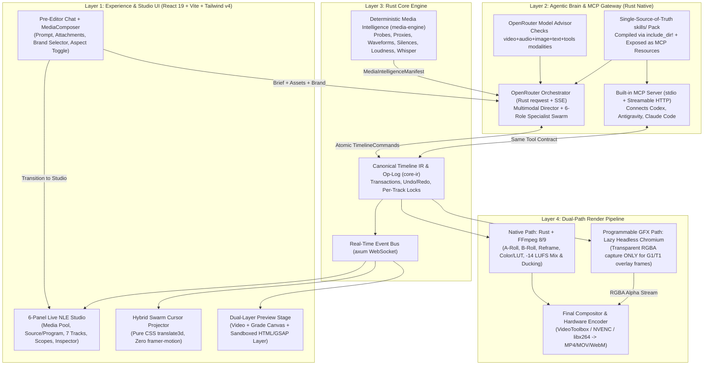

# Solaris Architecture

**Version:** 1.3.0  
**Status:** All 4 Phases Complete (Foundation, Desktop/Export, OpenRouter Swarm & MCP, Multimodal QA & Cloud/Docker Release)

---

## 1. Design Philosophy

Solaris is built around three non-negotiable engineering goals:

1. **Ultra-Lightweight Native Core**: No Electron, no Node.js agent sidecars (e.g., no Mastra). All timeline state, media intelligence, OpenRouter orchestration, and MCP serving run in a single compiled Rust binary (~15–25 MB) paired with a thin Tauri v2 shell in Phase 2.
2. **Dual-Path Hybrid Rendering**: Raw camera footage, smart `9:16` reframing, 3-way color grading, `.cube` LUTs, and broadcast audio mixing stay 100% native in **Rust + FFmpeg + GPU**. Headless Chromium is invoked **only** for time ranges containing custom HTML/CSS/GSAP/WebGL motion graphics (`G1 GFX` / `T1 TEXT`), streaming true RGBA alpha frames into FFmpeg's `overlay` filtergraph.
3. **Desktop-First, Web-Ready Transport Boundary**: The React UI **never** calls desktop-only IPC (`tauri::invoke`) for editor logic. Every mutation, query, media stream, and live cursor event flows through `packages/engine-client` over HTTP + WebSocket to `crates/server`.

---

## 2. Four-Layer System Architecture

---

## 3. The Transport Boundary (Desktop ↔ Web SaaS Portability)

| Concern | Local-First Desktop Mode | Future Web SaaS Mode |
| --- | --- | --- |
| **UI Transport** | `SolarisEngineClient` → `http://127.0.0.1:<port>` + `ws://` | `SolarisEngineClient` → `https://api...` + `wss://` |
| **Asset Storage (`AssetStorage` trait)** | `LocalFsStorage` (zero-copy local disk + range streaming) | `S3Storage` / `R2Storage` (signed URLs / object store) |
| **FFmpeg & Render** | Local `MediaToolchain` (VideoToolbox / NVENC) | Containerized Rust/FFmpeg worker pool |
| **Secrets** | OS Keychain via Tauri v2 (never in React state) | Server-side encrypted vault / session |

Because `apps/studio-web` only depends on `packages/engine-client`, **~95% of both the Rust backend and TypeScript frontend remain identical** between Desktop and Cloud deployments.

---

## 4. Workspace Crate & Package Map

- **`crates/core-ir`**: Pure Rust domain crate. Owns `Project`, 7 semantic `Track`s, `Clip` variants, `ColorGrade`, `BrandPlaybook`, `SavedCodeAsset`, `CodeAssetPackManifest` (`solaris.asset-pack/v1`), `ProjectTemplateInfo` (`talking-head-short`, `faceless-explainer`), `QaReport`, `SwarmRunStatus`, atomic `TimelineCommand`s, `ProjectEngine` (with undo/redo stacks & per-track concurrency locks), and atomic JSON persistence.
- **`crates/media-engine`**: Owns `AssetStorage` trait (`LocalFsStorage` & AWS SigV4 `S3Storage`), `MediaToolchain` capability detection, `ffprobe` JSON parsing, log-footage detection, `silencedetect` + `ebur128` LUFS parsing, raw `f32le` PCM waveform peak extraction, proxy generation, Whisper STT parsing (`transcribe.rs`), PNG frame capture (`frames.rs`), and dual-path FFmpeg + Chromium export (`export.rs`, `gfx_render.rs`).
- **`crates/agent-runtime`**: Native Rust OpenRouter SSE client (`openrouter.rs`), live `ModelAdvisor` (`advisor.rs`), OpenRouter STT (`stt.rs`), 36-tool `SolarisBackend` executor (`tools/`), embedded `skills/` (`include_dir!`), and Director + 6-role parallel Swarm (`swarm/`).
- **`crates/mcp-server`**: Built-in MCP server (`stdio` HTTP bridge + Streamable HTTP `/mcp`) exposing Solaris tools, `skill://*` / `solaris://*` resources, prompts, and the `solaris-mcp` CLI (`serve`, `list-skills`, `install-skills`).
- **`crates/server`**: `axum` 0.8 HTTP + WebSocket daemon (`lib` + `bin`). Exposes `/api/v1/*` REST routes, `/mcp` Streamable HTTP, `/api/v1/ws` live event stream, background media analysis tasks, and workspace persistence. Embedded directly by Tauri.
- **`packages/engine-client`**: Zero-dependency TypeScript SDK mirroring `core-ir` contracts and wrapping REST + auto-reconnecting WebSocket subscriptions.
- **`apps/studio-web`**: React 19 + Vite + Tailwind v4 implementation of the **Solaris Solar Horizon** UI (`PreEditorChat`, `StudioWorkspace`, `SwarmCursorLayer`, `BrandPlaybookDrawer`).
